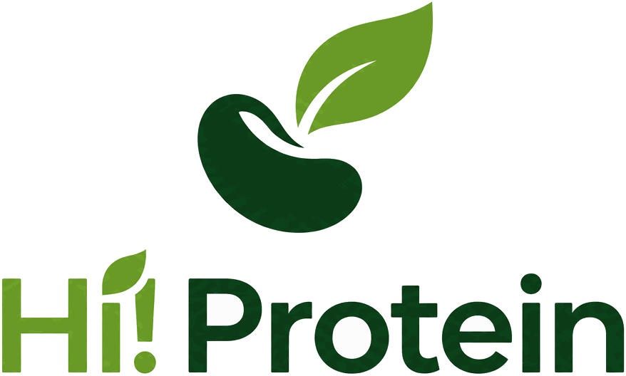

<p align="center">
  
</p>

<h1 align="center">Hi-Protein — Food Protein Decision &amp; Offtake Engine</h1>

<p align="center">
  <em>Will this field's harvest feed people, or livestock — and does either pay?</em>
</p>

<p align="center">
  <a href="../../actions/workflows/ci.yml"></a>
  
  
  
  <a href="LICENSE"></a>
</p>

---

Track 3, Hack the Fork Paris 2026, answering the brief directly:

> *How can artificial intelligence help farmers and regions produce the plant proteins
> people in France will eat tomorrow, and earn a living from them?*

**The pivotal number is the probability that a lot clears human-food specification.**
Below it, the harvest goes to animal feed at roughly a third of the price. So that one
probability — driven by July harvest rain, May insect pressure, and whether an optical
sorter sits within haulage range — decides both whether the farmer earns a living and
whether the crop feeds anyone. On green lentil the gap it is multiplying is about
**€630/t**. Nothing else in the system is as close to the brief.

The engine answers the brief's clauses in four places:

| Clause | Where |
|---|---|
| *produce the plant proteins* | the rotation engine: agronomic eligibility, yield distribution, paired three-year Monte Carlo |
| *people in France will eat* | `food_outcome` per parcel, and `/api/v1/food-demand` per region |
| *tomorrow* | `/api/v1/climate-outlook` and the `climate_horizon` option on every request |
| *earn a living from them* | the risk block: 70% bands, CVaR at 5%, probability of gain, breakeven grading fraction |

Built on real French open data. Agreste departmental yields, Météo-France climate
series, IGN RPG parcel geometry and ADEME Agribalyse impacts are all genuinely
fetched and parsed, not mocked. Buyer contract terms are the one deliberate
exception and are labelled as demo data everywhere they appear.

---

## Why the food tier, specifically

French policy set a 2030 target on *espèces riches en protéines* as a single block: 2 Mha,
8% of SAU, up from about 1 Mha in 2020, backed by €150.2 M of France Relance money.

**53% of that 1 Mha baseline was dehydrated alfalfa and artificial meadows** — forage, not
food. And the human-food tier inside it is the part that collapsed:

| Area (ha) | 2020 | 2022 | Change |
|---|---|---|---|
| All protein-rich crops | 1,083,763 | 1,045,800 | **−4%** |
| *Légumes secs* (lentil, chickpea, dry bean — the food tier) | 67,930 | 52,200 | **−23%** |
| Oilseeds, which had no growth target | 1,932,000 | 2,140,000 | **+11%** |

Target: +40%. Outcome: −4%, and −23% where it mattered most. Source: DGPE data in the
France Stratégie evaluation of France Relance, January 2024.

So this engine measures the food tier separately, and says so wherever it reports a
share — `sovereignty.target_basis` now states which denominator is in use, because
`national_target_pct` (grain pulses over *arable*) was being read as the PSN target
(all protein-rich crops over *SAU*), and they are not the same question.

---

---

## Quickstart

```bash
make install        # python venv + npm
make serve          # the whole app on http://localhost:5173
```

That is all a fresh clone needs. The trained yield model, the weather and training
panels and the baked department profiles are committed, so there is no data download and
no network access required to start. Rebuilding any of them, running it behind a proxy,
and offline mode are all covered in **[docs/RUNNING.md](docs/RUNNING.md)**.

```bash
make check          # lint + 299 tests, ~50 s
make smoke          # hit every endpoint against a running API
make audit          # perturb every assumption, report which flip a decision
make docker         # one 605 MB image: API + bundle + model, on one port
make help           # every target
```

---

## Documentation

| Read this | For |
|---|---|
| **[docs/STATUS.md](docs/STATUS.md)** | **Plain-language tour of all six screens, and what works today.** Start here. |
| [docs/ENGINE.md](docs/ENGINE.md) | What the engine computes, the models, the regional siting layer, the demand side, the climate horizons |
| [docs/ARCHITECTURE.md](docs/ARCHITECTURE.md) | Repository layout, the data lifecycle, the rebuild order |
| [docs/API.md](docs/API.md) | All 19 routes, request shapes, measured latency |
| [docs/DATA_SOURCES.md](docs/DATA_SOURCES.md) | Every URL, every parse recipe, and the confirmed dead ends |
| [docs/CHANGES_FROM_BLUEPRINT.md](docs/CHANGES_FROM_BLUEPRINT.md) | Why each modelling choice departs from the Track 3 brief |
| [docs/LITERATURE_AND_CALIBRATION.md](docs/LITERATURE_AND_CALIBRATION.md) | How the parameters check out against published work |
| [docs/LIMITATIONS.md](docs/LIMITATIONS.md) | Everything known to be weak about it |
| [docs/RUNNING.md](docs/RUNNING.md) | Every way to run it, and the proxy problems each one solves |
| [docs/DEPLOYMENT.md](docs/DEPLOYMENT.md) | Containerising it, hosting the frontend on Vercel, and managing the data |
| [CONTRIBUTING.md](CONTRIBUTING.md) | The rules that matter here, starting with provenance tags |

---

## What it is made of

```
backend/   FastAPI, 19 routes, a 20-module domain engine  (Python 3.11)
frontend/  React 18 + Vite + Tailwind, 6 views            (JSX)
ml/        quantile XGBoost + conformal calibration, and the adoption null result
scripts/   the data builders, the sensitivity audit, the smoke test
tests/     299 tests
data/      source downloads (ignored) and derived artifacts (committed)
docs/      the above
```

Full tree and module-by-module notes in
[docs/ARCHITECTURE.md](docs/ARCHITECTURE.md#repository-layout).

---

## Data sources

Every URL below was verified working while building this. Details, exact column
names and parse recipes are in [docs/DATA_SOURCES.md](docs/DATA_SOURCES.md).

| Layer | Source | Mode |
|---|---|---|
| Yields and areas, department × crop × year | Agreste SAA long series 2010–2025 (XLSX in a ZIP) | offline, cached |
| Climate | Météo-France *données climatologiques de base*, monthly, per department | offline, cached |
| Parcel geometry and declared crop history | IGN API Carto RPG v2 | live, cached |
| RPG crop code vocabulary, per campaign | IGN Geoplateforme WFS `RPG.<year>:codes_cultures` | verified offline |
| Parcel panel, Beauce, 10 campaigns 2015–2024 | IGN Geoplateforme WFS `RPG.<year>:parcelles_graphiques` | offline, cached |
| Department boundaries | IGN `ADMINEXPRESS-COG.LATEST:departement` | offline, cached |
| Carbon and LCA | ADEME Agribalyse v3.1, **agriculture stage only** | live, cached |
| Subsidies | PAC 2023–2027 coupled protein aid and eco-scheme | reference table |
| Prices, costs, buyers | RICA-consistent baselines; buyer terms are demo data | reference table |

**The one source trap that changes an answer.** Taken as published, the Beauce's
grain-legume share rises from 2.00% (2015) to 3.39% (2024) in RPG. Most of that is a
vocabulary change, not land-use change: three pulse codes (`PHF`, `PHS`, `FVP`) record
zero hectares there in every campaign to 2022 and appear at thousands of hectares in
2023, and they are **absent from the official 2022 code table and present in the 2023
one**. Like for like the figure is 2.00% → 2.39%, and 2015–2022 is flat at 2.00% →
1.99%. Lentil (`LEC`, a stable code) is the clean signal at 471 → 1,724 ha. Fetching
all ten campaigns rather than two endpoints is what made this visible — on two
campaigns a relabelling and a tripling look identical. Full workings in
[docs/DATA_SOURCES.md](docs/DATA_SOURCES.md#6b-the-land-change-view-what-moved-and-the-two-traps-in-measuring-it).

Two source choices worth flagging. Agreste SAA is not exposed through any API — the
Disar portal is a stateful JSF application with no JSON endpoint — but each dataset
page embeds a static bulk download link, which is what `ml/sources.py` uses. And
Agribalyse's *synthesis* value for dried lentil is 0.581 kg CO₂e/kg, of which 0.244
is retail transport and 0.129 is packaging; the agriculture stage is 0.141. A
farm-gate rotation comparison has to use the per-stage dataset or it overstates the
pulse footprint fourfold.

---

---

## What was changed from the blueprint

Twenty changes, each because the original would have produced a wrong number or
an indefensible claim. Summarised here, argued in full in
[docs/CHANGES_FROM_BLUEPRINT.md](docs/CHANGES_FROM_BLUEPRINT.md).

The four that matter most:

1. **Both rotations are simulated under shared draws.** The blueprint compared a
   stochastic pulse rotation against one deterministic baseline number, which credits
   the pulse with all of the baseline's good luck.
2. **Only year 2 changes.** The blueprint's own example switched year 2 from barley to
   lentil *and* year 3 from rapeseed to wheat, confounding the pulse effect with a
   separate crop switch.
3. **Disease return intervals apply to the host group, not the species.**
   *Aphanomyces euteiches* carries over between pea, lentil, alfalfa and any unnamed
   grain legume, so lentil after pea is exactly as dangerous as pea after pea. A
   per-species rule would have cleared it.
4. **`P_human` is a documented hazard model, not a trained classifier.** No French
   open dataset records per-lot grading outcomes, so there is no label to fit.
   Training on invented labels would make a fabricated number look like a
   measurement. Per-lot grading records from a cooperative silo are the single
   highest-value dataset a partner could contribute.

Four more found late, all worth knowing about:

- **Winter pea had no Agreste series** and was ranking first on a hand-written
  constant. Agreste publishes one pea series covering both habits, so winter pea is
  now that series with a documented uplift, and the response says so.
- **Fallow land is a first-class baseline.** In a live sample of 1,000 Beauce parcels,
  336 are declared fallow. Converting those displaces no crop margin: +€960/ha against
  −€274/ha for displacing the rapeseed that Eure-et-Loir actually grows. The engine
  also warns that fallow counts toward BCAE 8 and a grain legume does not. The gap
  between those two numbers is the clearest statement in the product of where a pulse
  pays: on land that is currently growing nothing, not on land growing a break crop.
- **An unnamed legume in the history now blocks a pea.** RPG code `PAG` declares a
  grain legume without naming the genus, and the code table had no entry for it at
  all. A parcel reading `BTH, PAG, ORH` came back clean; it now blocks both pea and
  lentil on a 2-year gap against a 6-year *Aphanomyces* interval.
- **`MLT` is Millet, not a legume mix.** It was mislabelled in every vintage, which
  would have shown a user millet as a nitrogen-fixing precedent.

---

---

## Known limitations

A long list, on purpose — see **[docs/LIMITATIONS.md](docs/LIMITATIONS.md)**. The
headline ones: yield labels are department means rather than parcel observations, margins
are operational gross margins rather than farm profit, buyer contract terms are
illustrative demo data, and the commune-level arable split behind the most persuasive map
in the product is right on average and wrong for any individual commune.

This is a hackathon prototype. It does not replace advice from a Chamber of Agriculture
or a cooperative agronomist, and no rule table substitutes for a soil *Aphanomyces* test.

---

## Licence and attribution

Code is licensed under the **Apache License 2.0** — see [LICENSE](LICENSE).

The underlying open data stays under the licences of Agreste, Météo-France, IGN and
ADEME, all of which require attribution. [NOTICE](NOTICE) carries it in full, and so does
the footer of the app.

Buyer contract terms and the livestock holding directory are illustrative demo data, not
commercial offers and not real farms. They are labelled as such everywhere they appear.
